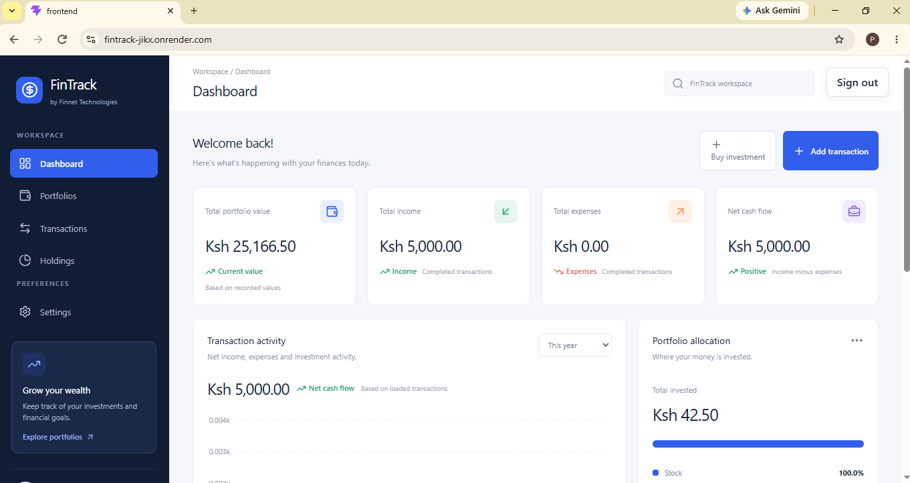
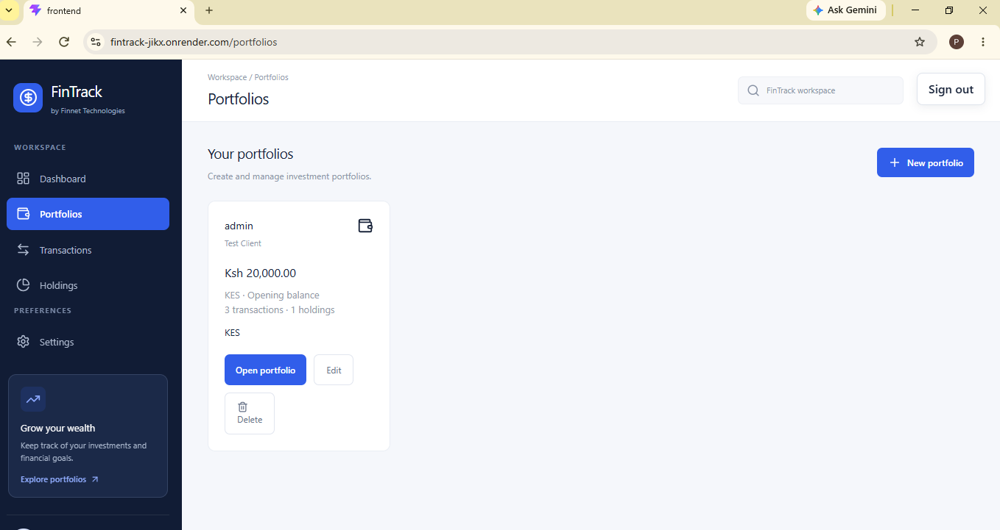
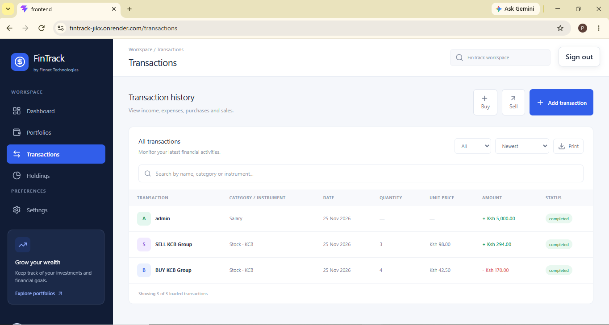
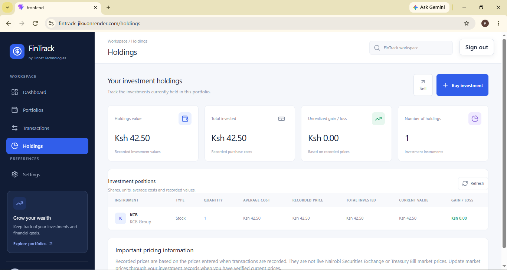

# FinTrack by Finnet Technologies

FinTrack is a branded portfolio and investment transactions tracker. An analyst can register client portfolios, record income, expense, BUY and SELL transactions against them, and review current holdings and a performance summary at a glance.

It is a full-stack application: a **Laravel REST API** with token authentication and a **React single-page app** that consumes only that API.

> Built for the Finnet Technologies Software Developer Technical Assessment. All data in the application is fictional.

## Live demo

| | |
|---|---|
| Frontend | https://fintrack-jikx.onrender.com |
| API base URL | https://fintrack-production-e3993c19.up.railway.app/api |
| API documentation (Swagger) | https://fintrack-production-e3993c19.up.railway.app/api/documentation |
| Repository | https://github.com/phan254/fintrack |

**Demo login**

- Email: `demo@gmail.com`
- Password: `Demo1234`

The demo account contains fictional sample portfolios and transactions. The credentials are for assessment review only.

> The free hosting plans may take a few seconds to wake up on the first request.

## Screenshots

| Dashboard | Portfolios |
|---|---|
|  |  |

| Transactions | Holdings |
|---|---|
|  |  |

## Features

### Backend API

- **Authentication:** register, log in, log out and fetch the current user. Passwords are hashed, and all other endpoints are protected with Laravel Sanctum bearer tokens. Tokens expire after a configurable period (default 8 hours).
- **Portfolios:** full CRUD with name, client name, base currency (KES or USD), opening balance and created date. Each portfolio belongs to the authenticated user, and other users' portfolios return `404`.
- **Transactions:** income, expense, BUY and SELL records. Supported instruments are `SCOM`, `KCB`, `EQTY` and `T-BILL-91`.
- **Holdings summary:** per-instrument net quantity, weighted average cost, total invested, current value and unrealised gain or loss, plus cash balance, total portfolio value and allocation by asset type.
- **Validation and errors:** invalid input (negative or zero quantities, unknown instruments, selling more than held, unknown portfolios) is rejected with the correct HTTP status code and a consistent JSON error body.
- **Safe deletes:** deleting an investment transaction recalculates the holding from the remaining trade history, and is refused if the remaining history would contain an invalid sale.
- **Persistence:** MySQL with migrations and a seeder.
- **API documentation:** OpenAPI annotations generate an interactive Swagger UI.

### Frontend

- Login and register screens with form validation and clear error messages.
- Session handling: the token is checked on load, and an expired or rejected session returns the user to the login screen with a message.
- Portfolio list with create, edit and delete (with a confirmation before deleting).
- Transaction table with search, type filter and sorting, plus forms for income, expense, BUY and SELL.
- Holdings page with positions, average cost, current value and gain or loss.
- Data visualisation: a transaction activity chart and a portfolio allocation bar.
- Loading, empty and error states for every API call.
- Currency formatting per portfolio, with income and expense colours shown alongside `+` and `-` signs.
- Responsive layout for desktop and mobile.
- Separate URLs for each page (`/`, `/portfolios`, `/transactions`, `/holdings`, `/settings`).
- Branding: "FinTrack by Finnet Technologies", the Finnet logo as the header logo and favicon, and a navy and blue palette.

## Architecture

```
React SPA (Vite)  --HTTPS/JSON-->  Laravel REST API  -->  MySQL
  Render (static)                   Railway               Railway
```

- **Frontend:** a React single-page app built with Vite. It talks to the API through a single Axios client (`frontend/src/api.js`) that attaches the bearer token and handles expired sessions.
- **Backend:** a Laravel API. Controllers handle HTTP, form requests and validation enforce input rules, and business rules (holdings, average cost, sale limits) live on the server so every client gets the same results.
- **Database:** MySQL stores users, portfolios, transactions and holdings.
- **Authentication:** Laravel Sanctum personal access tokens.
- **Documentation:** L5-Swagger generates the OpenAPI spec (`backend/storage/api-docs/api-docs.json`) and Swagger UI.

## Technology stack and rationale

| Layer | Technology | Why |
|---|---|---|
| API | PHP 8.4, Laravel 13 | Mature framework with migrations, an ORM, request validation and built-in auth tooling |
| Auth | Laravel Sanctum | Simple token authentication suited to an SPA and API |
| Database | MySQL | Relational storage that fits financial records |
| API docs | L5-Swagger (OpenAPI) | Interactive documentation generated from the code |
| Tests | PHPUnit | Feature tests for the API |
| Frontend | React 19, Vite | Fast development and small production builds |
| Routing | React Router | Separate URLs for each page |
| HTTP | Axios | Interceptors for the token and session expiry |
| Charts | Recharts | Declarative charts for React |
| Icons | Lucide React | Consistent icon set |
| Hosting | Railway (API and MySQL), Render (static frontend) | Managed hosting with HTTPS and environment variables |

## Repository structure

```
fintrack/
├── backend/                 Laravel API
│   ├── app/
│   │   ├── Http/Controllers/Api/
│   │   └── Models/
│   ├── config/
│   ├── database/
│   │   ├── migrations/
│   │   └── seeders/
│   ├── routes/
│   ├── storage/api-docs/    Generated OpenAPI spec
│   └── tests/
├── frontend/                React app
│   ├── public/              Logo and favicon
│   └── src/
│       ├── App.jsx          Pages, routes and forms
│       ├── AuthGate.jsx     Login, register and session handling
│       └── api.js           API client
├── docs/screenshots/
└── README.md
```

## Run it locally

### Requirements

- PHP 8.4 or later and Composer
- Node.js 20.19 or later (or 22.12 or later) and npm
- MySQL
- Git

### 1. Clone the repository

```bash
git clone https://github.com/phan254/fintrack.git
cd fintrack
```

### 2. Set up the backend

```bash
cd backend
composer install
cp .env.example .env        # on Windows: copy .env.example .env
php artisan key:generate
```

Create an empty MySQL database named `fintrack_db`, then check these values in `backend/.env`:

```
DB_CONNECTION=mysql
DB_HOST=127.0.0.1
DB_PORT=3306
DB_DATABASE=fintrack_db
DB_USERNAME=root
DB_PASSWORD=
```

Run the migrations (add `--seed` to create the default test user from `DatabaseSeeder`):

```bash
php artisan migrate --seed
php artisan serve
```

The API runs at http://127.0.0.1:8000 and the Swagger UI at http://127.0.0.1:8000/api/documentation.

### 3. Set up the frontend

In a second terminal:

```bash
cd frontend
npm install
npm run dev
```

The app runs at http://127.0.0.1:5173. In development, Vite proxies `/api` requests to `http://127.0.0.1:8000`, so no frontend environment file is needed. Register a new account on the login screen to start.

### Environment variables

**Backend (`backend/.env`)**

| Variable | Purpose |
|---|---|
| `APP_KEY` | Application key, generated with `php artisan key:generate` |
| `APP_ENV`, `APP_DEBUG`, `APP_URL` | Environment settings (`APP_DEBUG=false` in production) |
| `DB_*` | MySQL connection |
| `FRONTEND_URL` | The one frontend origin allowed by CORS |
| `SANCTUM_EXPIRATION` | Token lifetime in minutes (default 480) |

**Frontend**

| Variable | Purpose |
|---|---|
| `VITE_API_URL` | API base URL for production builds, for example `https://fintrack-production-e3993c19.up.railway.app/api`. If unset, the app uses `/api` (the development proxy) |

No real secrets are committed. Copy the `.env.example` files and fill in your own values.

## Testing

Backend feature tests (run from `backend/`):

```bash
php artisan test
```

They cover authentication and portfolio ownership, portfolio creation, BUY transactions and weighted average cost, SELL transactions and insufficient-holdings validation, unsupported instruments, portfolio summary calculations, and deleting investment transactions with holding recalculation. At the last run, 12 tests (62 assertions) passed.

Frontend checks (run from `frontend/`):

```bash
npm run lint
npm run build
```

## API overview

All endpoints are prefixed with `/api`. Everything except register and login requires `Authorization: Bearer <token>`. Full request and response details are in the Swagger UI.

**Authentication**

| Method | Endpoint | Description |
|---|---|---|
| POST | `/auth/register` | Register a user and receive a token |
| POST | `/auth/login` | Log in and receive a token |
| GET | `/auth/me` | Get the authenticated user |
| POST | `/auth/logout` | Revoke the current token |

**Portfolios**

| Method | Endpoint | Description |
|---|---|---|
| GET | `/portfolios` | List portfolios |
| POST | `/portfolios` | Create a portfolio |
| GET | `/portfolios/{portfolio}` | View a portfolio |
| PUT/PATCH | `/portfolios/{portfolio}` | Update a portfolio |
| DELETE | `/portfolios/{portfolio}` | Delete a portfolio |
| GET | `/portfolios/{portfolio}/summary` | Holdings and performance summary |
| GET | `/portfolios/{portfolio}/transactions` | List a portfolio's transactions |
| POST | `/portfolios/{portfolio}/transactions` | Record a BUY or SELL |

**Transactions**

| Method | Endpoint | Description |
|---|---|---|
| GET | `/transactions` | List transactions (filters: `portfolio_id`, `type`, `category`, `search`) |
| POST | `/transactions` | Create an income, expense, BUY or SELL |
| GET | `/transactions/{transaction}` | View a transaction |
| PUT/PATCH | `/transactions/{transaction}` | Update an income or expense |
| DELETE | `/transactions/{transaction}` | Delete a transaction |

BUY and SELL transactions cannot be edited. Deleting one recalculates the holding.

**Holdings**

| Method | Endpoint | Description |
|---|---|---|
| GET | `/holdings` | List holdings |
| POST | `/holdings` | Create a holding |
| GET | `/holdings/{holding}` | View a holding |
| PUT/PATCH | `/holdings/{holding}` | Update a holding |
| DELETE | `/holdings/{holding}` | Delete a holding |

## Deployment

**Backend and database (Railway)**

1. Create a project, add a MySQL service, and add this repository as a service.
2. Set the service Root Directory to `/backend` and the deploy branch to `main`.
3. Set the variables listed above, with the `DB_*` values referencing the MySQL service's variables.
4. Set the pre-deploy command to `php artisan migrate --force`.
5. Generate a public domain. PHP 8.4 is selected from `composer.json`, and proxy headers are trusted so that Swagger assets load over HTTPS.

**Frontend (Render)**

1. Create a static site from this repository with the branch `main`.
2. Set Root Directory `frontend`, build command `npm install && npm run build`, and publish directory `dist`.
3. Set `VITE_API_URL` to the Railway API URL. Vite reads it at build time, so redeploy after changing it.
4. Add a rewrite rule from `/*` to `/index.html` so that page refreshes work.

Secrets are configured in the platforms' environment variables and are never committed. CORS is restricted to the frontend origin through `FRONTEND_URL`. The deployment is intended to stay online for at least 14 days after submission.

## Assumptions and trade-offs

- Portfolios support KES and USD. Instruments are limited to SCOM, KCB, EQTY and T-BILL-91.
- Valuations use recorded prices from transactions. There is no live market-data feed, and the UI says so.
- A sale cannot exceed the quantity held, and BUY and SELL records are immutable, so history stays consistent. Deleting one recalculates the holding.
- Records are scoped to the authenticated user rather than shared across a team. There are no roles or permissions.
- The sample data in the live demo was entered through the application. `php artisan migrate --seed` only creates the default test user.
- Pages are switched in one large component (`App.jsx`), and the login screen uses inline styles. Both were quicker to build, and splitting them into components and shared CSS tokens would be the first clean-up.
- Authentication tokens are stored in `localStorage`, which is simple but exposed to XSS. A production system would prefer HttpOnly cookies.

## Next steps

- Seed a full demo dataset (portfolios and transactions) for the demo user.
- Add frontend component tests, Docker Compose, and a CI pipeline for lint and tests.
- Add CSV export and pagination controls for transactions.
- Add live market-data integration and dark mode using the shared design tokens.
- Split `App.jsx` into page components and move all styles to design tokens.

## AI tool usage

AI assistants were used during development for:

- Reviewing and improving the Laravel API implementation.
- Troubleshooting PHP, React, deployment and configuration issues.
- Preparing API documentation and project documentation.
- Reviewing test results and identifying missing requirements.

Suggestions were reviewed and tested in the project environment. The developer is responsible for the implementation, verification and final submission.

## Author

Phanuel Disi, [github.com/phan254](https://github.com/phan254)
